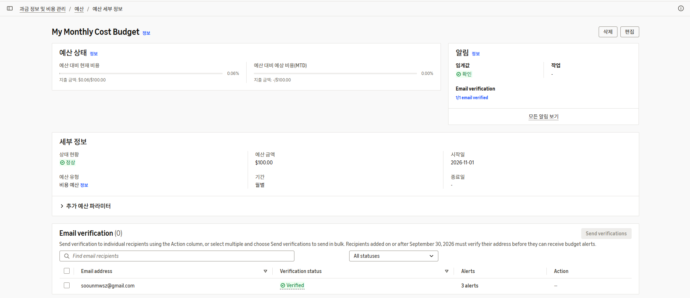
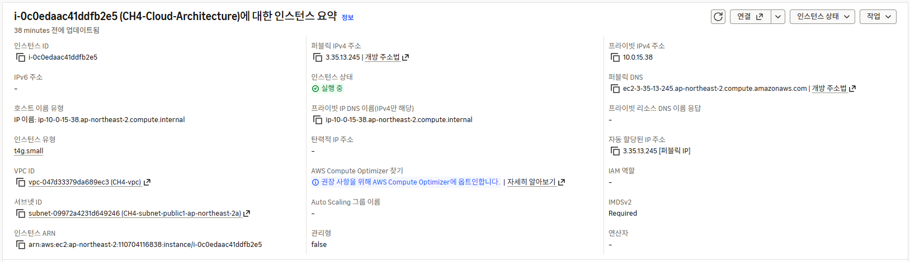

# 📗 CH4 클라우드 아키텍처 설계&배포 과제 

⭐ 네트워크를 구축, DB와 파일 저장소를 분리하여 서버가 죽어도 안전한 Stateless 아키텍처 완성 

---

## Level 0 -  AWS Budgets 설정

### 0-1. 설정 요구 사항
- 월 예산 &100 설정
- 예산 80& 도달 시 이메일 알람 설정 

### 0-2.과제 제출 요구사항

#### <설정완료 이미지 첨부>

#### <예산 알림 설정>

---

## Level 1 -  네트워크 구축 및 핵심 기능 배포
### 1-1. 인프라 구축

- VPC 설계 (Public/Private 분리 설정)

- EC2 생성 (Public subnet 1번으로 설정)
  - 인스턴스명 : CH4-Cloud-Architecture
  - 인스턴스 유형 : t4g.small
  - 가용 영역 : ap-northeast-2a
### 1-2. 애플리케이션
- 팀원 정보 저장 및 조회 API 개발 (생성 및 조회)
  - 파일경로 `project/api` API 및 테이블 명세서 작성

- 운영 설정(Profile 분리 및 로그 전략)
  - `application.yml` 형식
  - 로컬 H2 테스트 DB 사용
  - 운영 환경 MySQL 사용
  - 공용 / local / prod 구조로 분리 
  - 로그 전략 (interceptor 및 GlobalException 구현)

- 상태모니터링 (Actuator)
  - build.gradle 의존성 추가
  - yml 엔트포인트 설정 (health)

- 배포 및 검증
  - `active = local` 설정하여 배포 검증 완료

### 1-3. 배포 및 검증

**[EC2 배포 검증]**
  

**[EC2 Public IP]**

---

## Level 2 - DB 분리 및 보안 연결하기

### 2-1. 인프라 요구사항
#### RDS 구축
  - 엔진 옵션 : MySQL
  - 인스턴스 크기 : 프리티어(샌드박스) 설정
  - 자격 증명 관리 : 자체 관리로 설정
  - 초기 데이터베이스 이름 : CH4
  - 퍼블릭 액세스 : “예”
  - 기존 VPC 보안 그룹 : CH4-sg 설정
  - 보안 그룹 인바이트 추가 (3306)

  

#### 보안 그룹 체이닝
  

#### Parameter store
- AWS Parameter Store (url, name, password) 값 생성
  - `/cloud-architecture-app/prod/**` 이름 설정 

### 2-2. 애플리케이션 요구사항
- Spring Boot 실행 Parameter Store 값 주입받아 RDS 연결

- Actuator info 확장
  - 공통 파일에 endpoint 설정 및 info `team-name` 외부 주입 설정
  - Prod 파일에 import 주소 설정

### 2-3. 검증
