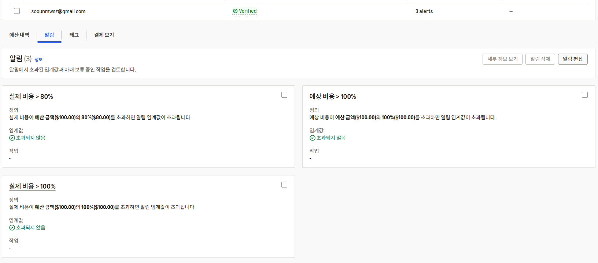

## CH4 클라우드_아키텍처 설계 & 배포 과제 

네트워크를 구축하고, DB와 파일 저장소를 분리하여 서버가 죽어도 안전한 Stateless 아키텍처를 완성 목표

---

## 0. AWS Budgets 설정
- 월 예산 &100 설정
- 예산 80& 도달 시 이메일 알람 설정 

#### <이미지 첨부>

#### <예산 알림 설정>

---

## 1. 네트워크 구축 및 핵심 기능 배포
### 인프라 구축
- VPC 설계 (Public/Private 분리 설정)
- EC2 생성 (Public subnet 1번으로 설정)

### 애플리케이션
- 팀원 정보 저장 및 조회 API 개발 (생성 및 조회)

- 운영 설정(Profile 분리 및 로그 전략)
  - `application.yml` 형식
  - 로컬 H2 테스트 DB 사용
  - 운영 환경 MySQL 사용
  - 공용 / local / prod 구조로 분리 
  - 로그 전략 (interceptor 및 GlobalException 구현)
- 상태모니터링 (Actuator)
  - build.gradle 의존성 추가
  - yml 엔트포인트 설정 (health)
- 배포 및 검증
  - `active = local` 설정하여 배포 검증 완료

### 